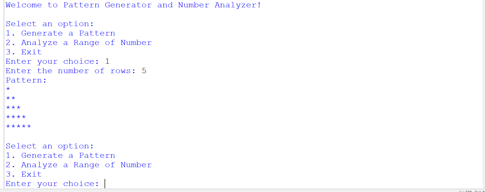
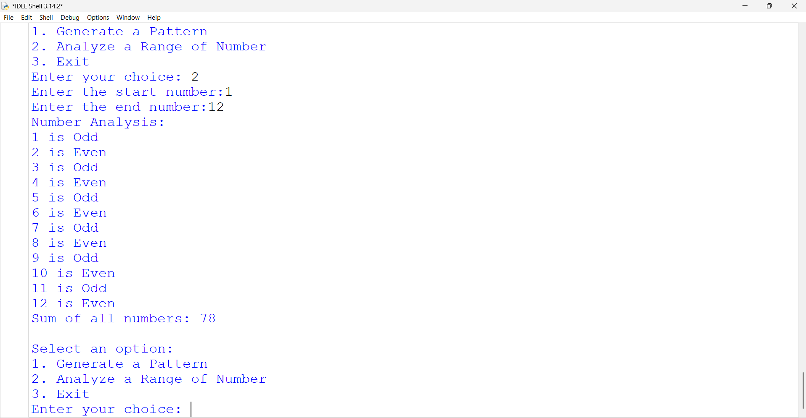
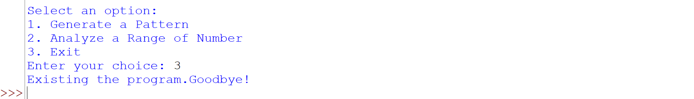

🧠 Logic Box

🚀 Pattern Generator & Number Analyzer

📌 About The Project

Logic Box is a menu-driven Python application that combines a Pattern Generator and a Number Analyzer.

This project helps beginners understand loops, conditional statements, user input, and basic logical problem-solving.

✨ Features

- ⭐ Generate a right-angled star triangle.
- 🔢 Identify odd and even numbers.
- ➕ Calculate the sum of a number range.
- 📋 Simple menu-driven interface.
- 🔁 Practice "for" and "while" loops.
- 🛡️ Handle invalid user inputs.
- 🚦 Learn "break", "continue", and "pass".

🖥️ Output Preview

⭐ 1. Pattern Generator

🔢 2. Number Analyzer

🚪 3. Exit Program

🛠️ Technologies Used

- Language: Python 3
- IDE: Python IDLE
- Interface: Console / Terminal

▶️ How to Run

1. Download or clone this repository.
2. Open the project folder.
3. Run the Python file:

python Project2LogicBox.py

Replace the filename with your actual Python filename if different.

📚 Concepts Learned

Concept Used

- "for" loop| Repeat operations
- "while" loop| Repeat the menu
- "range()"| Generate number sequences
- "Nested loops"| Generate patterns
- "if-elif-else"| Make decisions
- "break"| Stop a loop
- "continue"| Skip an iteration
- "pass"| Placeholder statement

# Author 
Prince Shah

Domain: Python – Data Science
Level: Beginner
